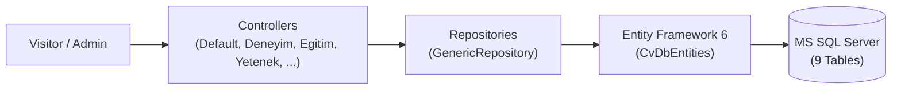

<p align="right"><a href="README.md">TR</a> | <b>EN</b></p>

# 🧾 ASP.NET MVC 5 Dynamic CV Website & Admin Portal

<p>
  
  
  
  
  
</p>

Dynamic personal resume (CV) web application built with **ASP.NET MVC 5**, **Entity Framework 6 (Database-First)**, and the **Generic Repository** pattern, featuring an **AdminLTE** management portal to control every section of the resume dynamically.

---

## ✨ Key Features

- **Generic Repository Pattern:** Central `GenericRepository<T>` class abstracting CRUD operations (`List`, `TAdd`, `TDelete`, `TGet`, `TUpdate`, `Find`) across all 9 SQL Server tables.
- **Dynamic Single-Page Resume:** About, Experience, Education, Skills, Interests, Certificates, Social Links, and Contact Form sections rendered dynamically via `Html.Action` partial views.
- **Full Admin Dashboard:** Create, update, delete, and toggle records for all sections, with dynamic skill progress bars (`progress-bar`) and timeline views for certificates and incoming messages.
- **Authentication (`FormsAuthentication`):** Global `[Authorize]` filter protecting admin controllers while allowing public access to `DefaultController` and `LoginController` via `[AllowAnonymous]`.

---

## 🏗️ Architecture & Database Schema (`DbCv`)



| Entity (`Cv_MVC.Models.Entity`) | Description |
|---|---|
| `Table_Hakkimda` | Personal profile details (name, address, phone, email, avatar URL, bio) |
| `Table_Deneyimlerim` | Work & internship experiences (`Baslik`, `AltBaslik`, `Aciklama`, `Tarih`) |
| `Table_Egitimlerim` | Academic education records & GPA with DataAnnotations validation |
| `Table_Yeteneklerim` | Technical skills and proficiency percentages (`0–100`) |
| `Table_Sertifikalarim` | Certificates and achievements |
| `Table_Hobilerim` | Personal interests and hobby descriptions |
| `Table_SosyalMedya` | Social media links, FontAwesome icon classes, and active status flags |
| `Table_Iletisim` | Visitor contact messages with timestamps |
| `Table_Admin` | Admin portal credentials |

---

## 🖼️ Screenshots

### 1. Public Resume Page (`/Default/Index`)
<p align="center">
  
</p>

### 2. Admin Login Page (`/Login/Index`)
<p align="center">
  
</p>

### 3. Admin Panel (`/Deneyim/Index`, `/Yetenek/Index`, `/Sertifika/Index`)
<p align="center">
  
</p>

---

## 📁 Project Structure

```text
aspnet-mvc-cv-website/
├── App_Start/
│   ├── BundleConfig.cs
│   ├── FilterConfig.cs                      # Global AuthorizeAttribute registration
│   └── RouteConfig.cs                       # Default route: {controller}/{action}/{id}
├── Controllers/                             # 12 MVC Controllers
├── Models/Entity/                           # Entity Framework DbContext & 9 entity classes
├── Repositories/                            # GenericRepository<T> & entity repositories
├── Views/                                   # 36 Razor (.cshtml) views & partial views
├── Cv_MVC.sln / Cv_MVC.csproj
├── Global.asax / Global.asax.cs
├── Web.config.example                       # Sample SQL Server connection configuration
├── LICENSE
├── README.md                                # Turkish documentation (default)
└── README.en.md                             # English documentation
```

---

## ⚙️ Setup & Running Locally

1. Clone the repository and open `Cv_MVC.sln` in **Visual Studio**.
2. Copy `Web.config.example` to `Web.config` and update `YOUR_SQL_SERVER` in the `CvDbEntities` connection string.
3. Restore NuGet packages and start the project with **IIS Express (`F5`)**.

---

## 🎨 UI Templates & Credits

This project integrates the following open-source frontend templates into ASP.NET MVC Razor (`.cshtml`) views:

- **Public Resume Theme:** [StartBootstrap — Resume](https://startbootstrap.com/theme/resume) ([MIT License](https://github.com/StartBootstrap/startbootstrap-resume/blob/master/LICENSE))
- **Admin Dashboard Theme:** [ColorlibHQ — AdminLTE 3.0.4](https://adminlte.io/) ([MIT License](AdminLTE-3.0.4/LICENSE))
- **Admin Login Theme:** [Colorlib — Login Form v20](https://colorlib.com/wp/template/login-form-20/)
- **Course Reference:** Developed following Murat Yücedağ's *ASP.NET MVC5 Dynamic CV Website* curriculum.

---

## 📄 License

Project source code is licensed under the [MIT License](LICENSE).
