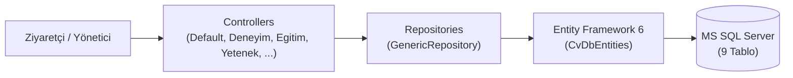

<p align="right"><b>TR</b> | <a href="README.en.md">EN</a></p>

# 🧾 ASP.NET MVC 5 Dinamik Özgeçmiş (CV) ve Yönetim Sistemi

<p>
  
  
  
  
  
</p>

**ASP.NET MVC 5**, **Entity Framework 6 (Database-First)** ve **Generic Repository** tasarım deseni kullanılarak geliştirilen, yönetici paneli (**AdminLTE**) üzerinden tüm içeriği dinamik olarak güncellenebilen kişisel özgeçmiş (CV) web uygulaması.

---

## ✨ Temel Özellikler

- **Generic Repository Tasarım Deseni:** Tüm veritabanı tabloları için ortak CRUD işlemlerini (`List`, `TAdd`, `TDelete`, `TGet`, `TUpdate`, `Find`) soyutlayan `GenericRepository<T>` mimarisi.
- **Dinamik Özgeçmiş (Ön Yüz):** Hakkımda, Deneyimlerim, Eğitim Hayatım, Yeteneklerim, Hobilerim, Sertifikalarım, Sosyal Medya İkonları ve İletişim Formu bölümleri `Html.Action` parçalı görünümleriyle (`PartialView`) veritabanından dinamik olarak yüklenir.
- **Kapsamlı Yönetim Paneli:** Tüm özgeçmiş bölümleri için ekleme, silme, güncelleme ve aktif/pasif durum yönetimi; yetenek oranlarına göre dinamik renkli ilerleme çubukları (`progress-bar`) ve zaman çizelgesi (`timeline`) görünümleri.
- **Kimlik Doğrulama (`FormsAuthentication`):** Global `[Authorize]` filtresi ile korunan yönetim sayfaları ve yalnızca ziyaretçi sayfalarına (`DefaultController`, `LoginController`) tanınan `[AllowAnonymous]` erişimi.

---

## 🏗️ Mimari ve Veritabanı Yapısı (`DbCv`)



| Tablo Sınıfı (`Cv_MVC.Models.Entity`) | Açıklama |
|---|---|
| `Table_Hakkimda` | Ad, soyad, adres, telefon, e-posta, profil fotoğrafı ve özet biyografi |
| `Table_Deneyimlerim` | İş ve staj deneyimleri (`Baslik`, `AltBaslik`, `Aciklama`, `Tarih`) |
| `Table_Egitimlerim` | Akademik eğitim geçmişi ve GNO bilgileri (`Required` doğrulama destekli) |
| `Table_Yeteneklerim` | Teknik yetenekler ve yüzdelik yetkinlik oranları (`0–100`) |
| `Table_Sertifikalarim` | Sertifika ve başarı kayıtları |
| `Table_Hobilerim` | İlgi alanları ve hobi açıklamaları |
| `Table_SosyalMedya` | Sosyal medya hesap bağlantıları, FontAwesome ikon sınıfları ve aktiflik durumu |
| `Table_Iletisim` | Ziyaretçilerin iletişim formundan gönderdiği mesajlar ve tarih bilgisi |
| `Table_Admin` | Yönetim paneli kullanıcı adı ve şifre kayıtları |

---

## 🖼️ Ekran Görünümü

### 1. Ziyaretçi Özgeçmiş Sayfası (`/Default/Index`)
<p align="center">
  
</p>

### 2. Yönetici Giriş Ekranı (`/Login/Index`)
<p align="center">
  
</p>

### 3. Yönetim Paneli (`/Deneyim/Index`, `/Yetenek/Index`, `/Sertifika/Index`)
<p align="center">
  
</p>

---

## 📁 Proje Yapısı

```text
aspnet-mvc-cv-website/
├── App_Start/
│   ├── BundleConfig.cs
│   ├── FilterConfig.cs                      # Global AuthorizeAttribute tanımı
│   └── RouteConfig.cs                       # Varsayılan rota: {controller}/{action}/{id}
├── Controllers/                             # 12 MVC Controller sınıfı
├── Models/Entity/                           # Entity Framework DbContext ve 9 tablo sınıfı
├── Repositories/                            # GenericRepository<T> ve varlık repository sınıfları
├── Views/                                   # 36 Razor (.cshtml) görünüm ve parçalı görünüm dosyası
├── Cv_MVC.sln / Cv_MVC.csproj
├── Global.asax / Global.asax.cs
├── Web.config.example                       # Örnek SQL Server bağlantı yapılandırması
├── LICENSE
├── README.md                                # Türkçe dokümantasyon (varsayılan)
└── README.en.md                             # İngilizce dokümantasyon
```

---

## ⚙️ Kurulum ve Çalıştırma

1. Repoyu klonlayın ve `Cv_MVC.sln` dosyasını **Visual Studio** ile açın.
2. `Web.config.example` dosyasını `Web.config` olarak kopyalayın ve `CvDbEntities` bağlantı cümlesindeki `YOUR_SQL_SERVER` alanını kendi SQL Server örneğinizle güncelleyin.
3. NuGet paketlerini geri yükleyin (`Restore NuGet Packages`) ve **IIS Express (`F5`)** ile projeyi başlatın.

---

## 🎨 Kullanılan Arayüz Şablonları ve Kaynaklar (Credits)

Bu projede ön yüz, yönetim paneli ve giriş ekranı için aşağıdaki açık kaynaklı arayüz şablonları kullanılmış ve ASP.NET MVC Razor (`.cshtml`) yapısına uyarlanmıştır:

- **CV / Özgeçmiş Ön Yüz Teması:** [StartBootstrap — Resume](https://startbootstrap.com/theme/resume) ([MIT Lisansı](https://github.com/StartBootstrap/startbootstrap-resume/blob/master/LICENSE))
- **Yönetim Paneli (Admin) Teması:** [ColorlibHQ — AdminLTE 3.0.4](https://adminlte.io/) ([MIT Lisansı](AdminLTE-3.0.4/LICENSE))
- **Yönetici Giriş (Login) Teması:** [Colorlib — Login Form v20](https://colorlib.com/wp/template/login-form-20/)
- **Eğitim / Mimari Referansı:** Murat Yücedağ — *ASP.NET MVC5 ile Sıfırdan Admin Panelli Dinamik CV Sitesi* kursu kapsamında geliştirilmiştir.

---

## 📄 Lisans

Proje kaynak kodları [MIT Lisansı](LICENSE) altında sunulmaktadır.
